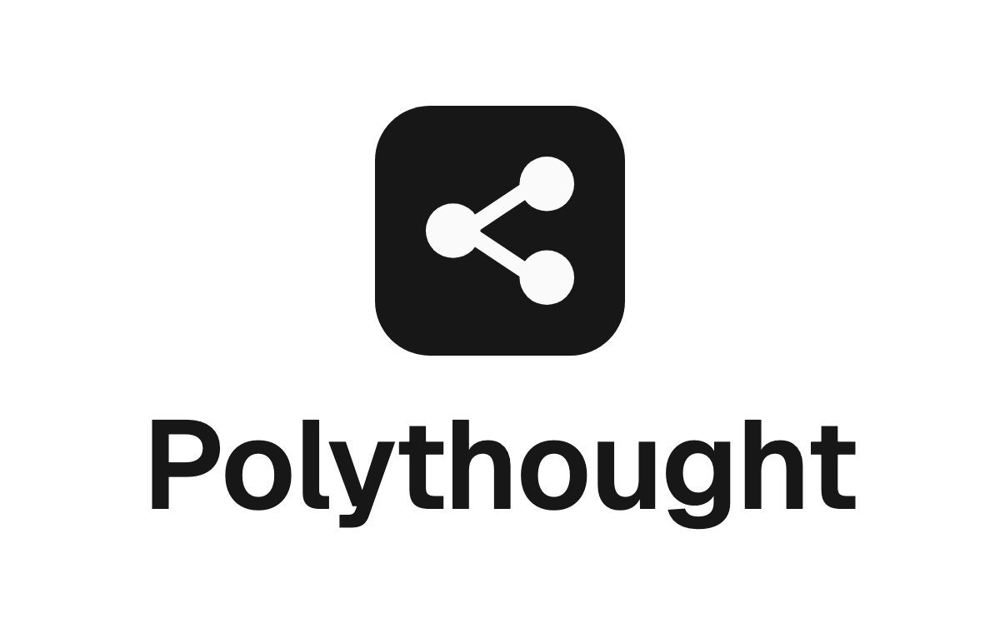

<p align="center">
  <picture>
    <source media="(prefers-color-scheme: dark)" srcset=".github/readme/lockup-dark.png">
    
  </picture>
</p>

<p align="center">
  <b>Workflow automation for Polymarket.</b><br>
  Build workflows from nodes, run them on a schedule or on live market activity, and share them.<br>
  Self-hosted.
</p>

<!-- The video: upload it on github.com, then paste its user-attachments link here, on a line of its own. -->

Polythought is a workflow builder for Polymarket that you run on your own server. Its
workflows watch markets, follow traders, ask a language model, message you on Telegram, and
trade, on paper or with real money. You build them on a canvas or write them in TypeScript,
and agents such as Claude Code or Codex can build and run them with you over MCP.

## Features

**Build**

- **Canvas.** Search the node list, drag nodes in, and connect them port to port. Undo and
  redo, copy and paste between workflows, and keyboard shortcuts you can rebind.
- **Workflow as code.** Read and edit any workflow as TypeScript, type-checked as you write,
  then apply it back to the canvas.
- **Expressions.** `{{ }}` in any setting, in the same language and sandbox as code.
- **Code and custom nodes.** Transform, filter, route or aggregate items in TypeScript, or make
  a node type of your own with its settings, outputs and code. User code runs in QuickJS-NG
  compiled to WebAssembly under wazero, a fresh instance for each run.
- **Runs.** Every run is kept and replayed on the canvas, with the items each node passed on.
  Fields are checked as you type them.

**Workflows**

- **Nodes** for each step: triggers (by hand, on a schedule, on market activity, on traders'
  trades, on your own orders, on a Telegram message), Polymarket data, logic, transforms,
  code, trading, Telegram, webhooks and AI.
- **Library.** Ready-made workflows to copy and change, and the ones members share, with
  their wallets, credentials and webhook URLs left behind.
- **Alerts** to Telegram, Discord, Slack or any JSON endpoint.
- **Waits.** A run that waits, for a time or for an answer on Telegram, keeps nothing busy
  and carries on after a restart.

**Trading**

- **Copy traders.** Follow traders' wallets and copy their trades a few seconds after they
  make them, sized and limited as you say, or only once several of them agree.
- **Paper trading.** Paper orders fill against the live order book, paying the taker fee
  Polymarket would, with profit and loss per trader.
- **Live trading.** Orders are signed in Go as EIP-712, for EOA, proxy, Safe and Deposit
  Wallet accounts, from a session key you authorise in MetaMask or Rabby. Each order is
  recorded before it is sent, so a timeout never places it twice.
- **Safety.** A Risk guard node keeps trades within limits per market, per day and per price.
  Admins cap live orders, and a kill switch in the app and on Telegram stops live trading.
  Live trading is off until an admin turns it on.

**AI and agents**

- **AI agent node.** Ask a model about each item, with your own key: Anthropic, Gemini, or
  anything OpenAI-compatible, such as OpenRouter or a model on your network. Answers come
  back as text, as fields or to a JSON schema, and the model can look things up with
  read-only market tools. Spend is capped each month.
- **Local agent node.** Hand a task to your own Claude Code or Codex and wait for its answer.
- **Agents over MCP.** Connect Claude Code, Codex, Gemini CLI, Cursor, opencode or VS Code.
  They sign in with OAuth 2, get the scopes you tick, from read to live, and anything live
  waits for your confirmation in the app or on Telegram. A
  [Claude Code plugin](integrations/claude-code) comes with it.

**Plugins**

- Plugins written in Go, over gRPC, bring nodes, triggers and credential types of their own.
  An admin approves what each asks for, signed with minisign or flagged as not.
- On Linux 6.2 or newer they run sandboxed, under Landlock, seccomp and rlimits, with caps on
  their memory and data. See the [example plugin](examples/plugins/movers).

**Platform**

- One Go binary is the API, the MCP endpoint, the code runner and the sandbox launcher,
  beside PostgreSQL. Caddy serves the web app and the docs.
- Admins configure the instance in the browser, with a history of every change, and can
  restart it from there. Sign-up is open, by invite or closed.
- A Telegram bot for your workflows, traders, positions and notifications.
- Secrets are encrypted at rest with AES-256-GCM, a key for each, and passwords are hashed
  with Argon2id.

## Run it

You need Docker with Compose, plus `openssl` and `make`.

1. Copy the settings file:

   ```sh
   cp .env.example .env
   ```

2. Fill in `.env`:
   - `POLYTHOUGHT_SECRET_KEYS`: the key that encrypts stored secrets. Make one with
     `echo "k1:$(openssl rand -base64 32)"`, and keep it safe.
   - `POLYTHOUGHT_ADMIN_EMAIL` and `POLYTHOUGHT_ADMIN_PASSWORD`: the first admin, at least 12
     characters of password.

3. Start it, with the released images:

   ```sh
   docker compose -f deployments/docker-compose.yml --env-file .env --profile app up -d
   ```

   Or build the images from the code with `make up`.

4. Open <http://localhost:3000> and sign in as the admin.

Images are published for `linux/amd64` and `linux/arm64`. Before others use your instance,
see [Install](docs/src/content/docs/self-hosting/install.md) for its address, HTTPS and the
database password.

## Develop

You need Go 1.27, Node 26 (`nvm use` reads it from `.nvmrc`), pnpm and Docker.

| Command | What it does |
|---|---|
| `make db-up` | Starts PostgreSQL alone on port 5432. |
| `make run` | Runs the API on port 8080 with the settings in `.env`. |
| `make web-dev` | Runs the app on port 5173, with live reload. |
| `make docs-dev` | Runs the docs on port 4321. |
| `make check` | Format, vet, lint and unit tests, as CI runs them. |
| `make help` | Lists every target. |

```text
cmd/polythought        the server: API, MCP endpoint, code runner, sandbox launcher
internal/core          the engine, the nodes and the services
internal/adapters      HTTP, PostgreSQL, the sandbox, the plugin host, the JS runtime, Telegram, …
pkg/clients/polymarket a Go client for Polymarket, order signing included
pkg/plugin             the plugin SDK
web                    the React app
docs                   the docs site
deployments            Docker Compose and the server's Dockerfile
examples/plugins       an example plugin
integrations           the Claude Code plugin
```

## Docs

Every instance serves the docs at `/docs`. To read them here:

- [Concepts](docs/src/content/docs/guides/concepts.md),
  [the editor](docs/src/content/docs/guides/editor.md) and
  [workflows as code](docs/src/content/docs/guides/workflow-code.md)
- [Custom nodes](docs/src/content/docs/guides/custom-nodes.md) and
  [copy traders](docs/src/content/docs/guides/copy-traders.md)
- [Agents over MCP](docs/src/content/docs/guides/agents-over-mcp.md)
- [Install](docs/src/content/docs/self-hosting/install.md) and
  [write a plugin](docs/src/content/docs/self-hosting/write-a-plugin.md)
- [How it is built](docs/src/content/docs/architecture/overview.md)

## License

[PolyForm Noncommercial 1.0.0](LICENSE): free to use, change and share for any
noncommercial purpose.

Polythought is not affiliated with Polymarket. Live trading places real orders from your
wallet: use it at your own risk, start on paper, and check that Polymarket allows trading
where you are.
