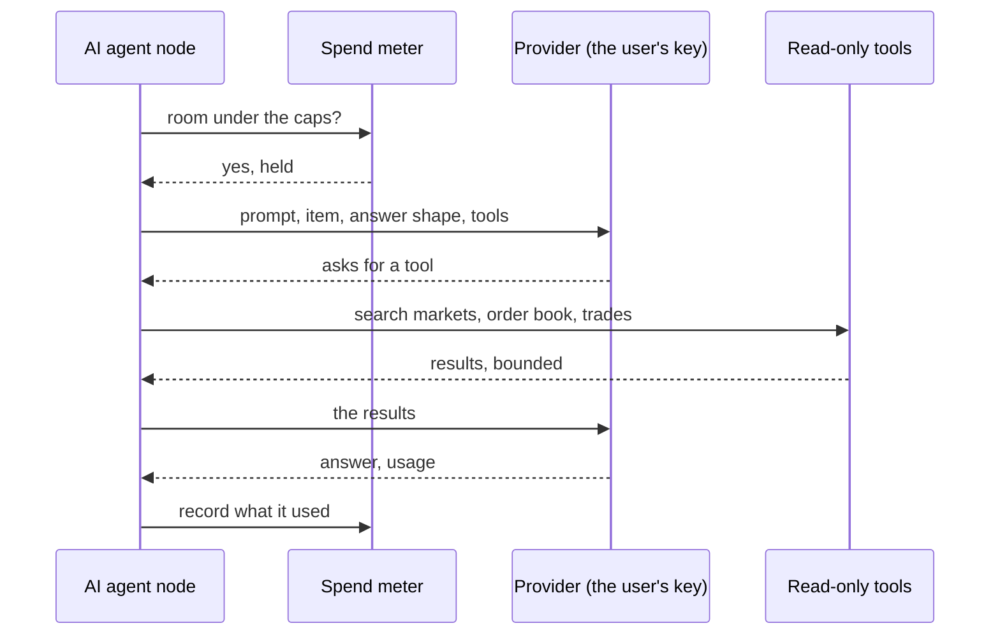

The **AI agent** node asks a language model about items and sends the answers on. It calls
Anthropic, Gemini, or any OpenAI-compatible API (OpenRouter, a local server), with a key its
owner keeps in their credentials. The instance holds no key of its own, and nothing calls a
provider but a user's own workflow.

## The node

It calls the model once per item, four at a time, or once for all items together. Its answer
is text, fields from a table the owner fills in, or JSON matching a schema, checked, with up to
three retries; a refusal fails the item at once. Each answer carries the model, why it
stopped, its usage and its cost where the provider reports one.

The model may be given five tools, none on to start with, all read-only: search markets, an
order book, price history, recent trades, a public address's positions. Each call and each
result is bounded, ten calls by default and twenty results each; at the limit, the model is
told to answer with what it has. There is no tool that trades: an agent's answer reaches an
order only through the workflow's own trading nodes and their checks.

## Keys

Each user brings their own key, kept sealed in their credentials, and picks it in the node.
Agents use API keys only, never a subscription's login such as `claude` or `codex`, even on a
self-hosted instance: a subscription's terms forbid serving other people from it, and a key
keeps each user's calls on their own account.

An OpenAI-compatible key may name its own address. The server reaches it only at a public
address over https, through the guard webhooks use; a model on the same machine or network,
over plain http, needs an admin to allow private addresses.

## Spend

Each call is recorded against its owner's month as soon as it returns, even when its run was
cancelled. An admin caps a month's spend for the instance and per user, in tokens and in
dollars ($20 and 20 million tokens unless changed), and the node may cap its own run.
Dollars are only what a provider reports, as OpenRouter does; there is no price table to go
stale.

Before each call the meter checks the user's kill switch (if they chose that it stops their
agents too), the run's caps, then the month's: what is recorded, plus what calls in flight
hold, plus this call's estimate. Holding what calls in flight may spend keeps a cap from being
passed by much when many run at once. Users are told at 80% of a cap and at the cap, once a
month each.

## Agents over MCP

A coming part of Polythought lets agents such as Claude Code and Codex work with it as their
user does, over an MCP server in the app; and lets a workflow hand a task to its owner's own
agent. The sign-in is built: an OAuth 2.1 server in the app, where the user allows an agent
scopes on a consent page and revokes it on Settings, as
[the security model](/docs/architecture/security/#accounts) describes.

So is the endpoint, `/mcp`: the official Go SDK's MCP server, over Streamable HTTP, inside the
API server. An agent's OAuth token works there, and so does an API token, each with its
scopes; a request without one is told where to sign in. Each tool asks for a scope, and each
agent or token may call 120 a minute unless an admin changes it; an answer is kept under
about 8,000 tokens, and a list comes a page at a time.

The tools so far read what the user builds: their workflows, as JSON or as the TypeScript the
Code view shows (the server prints it as the app does, held to it by shared tests), their
problems, their executions and the first items a run by hand kept, the node types with their
settings, the code SDK's declarations, and the library. Text others wrote, a plugin's words,
another user's library entry, what flowed through a workflow from the markets, comes in fields
named `untrusted`, which the server tells agents are data, never instructions. A workflow's
personal settings, such as a webhook's URL, show only as set unless the user lets agents see
them.

Agents read the markets with the AI agent node's own five tools, the same code answering
both, and one market's details beside them; and the user's money: their wallets and the pUSD
in each, how each workflow trades and has done, its orders, and the live order log.

With the build scope they build workflows: make one from workflow code or from its graph as
JSON, change one on the version they read, as the editor does, run it, switch it on and off,
and cancel an execution that waits. An agent's code runs where the user's would, held to the
same limits, and only for a user who may write code. A workflow it makes is laid out as the
canvas lays one out; one it changes keeps its nodes where they were, and a new node goes
beside the one feeding it, as the editor places them, the server's placing held to the app's
by shared tests. A refused save tells the agent each problem, and code that does not compile,
each line and column. Deleting a workflow, which the tool marks as destructive, and sharing
one to the library work only where the user lets agents and tokens do them, two switches on
Settings, off to start with.

They make the user's custom nodes too, the form and the TypeScript, and change them on the
version read; a change that would break workflows using one is refused, saying which and
how, and made once the agent calls again with confirm, as a user presses Save anyway. They
list credentials by name and kind, to pick in nodes, and keep ones the user gives them, the
secret sealed and never given back. As a workflow can send a credential wherever its nodes
call, a third switch, off to start with, decides whether agents and tokens may make
credentials work: save, switch on or run a workflow that uses one, test one, or change where
one goes. Deleting custom nodes and credentials takes the delete switch, as workflows do.

An agent sees what a waiting execution asks, the Telegram question as it was sent, under
`untrusted` as its items' fields are others' words, and its buttons; each wait that can be
answered keeps that beside its key. It presses a button only where the user lets agents and
tokens answer, a switch of its own, off to start with, as a question is often how the user
approves a step; the question then says which agent answered. Agents use library entries,
any of them, the workflow made switched off; for another user's entry the answer names the
code it brings, which `get_template` gives in full, for the user to read before it runs. They
share the user's workflows and take the user's entries down where the share switch lets
them.

What reaches real money waits for the user where they say so: going live, switching on or
running a workflow that trades live, changing one that is on, and turning the kill switch
off, a switch each on Settings, on to start with. An agent's or a token's such action is
checked as any would be, its scopes and all, then kept as a confirmation, with who asked,
what it does in a sentence, and what carrying it out needs; the agent hears that it waits,
and `get_confirmation` says how it went. The user confirms or refuses it at a browser,
from a bar on every page, before it expires, an hour unless an admin changes it; confirmed,
it is carried out as the agent asked, with its scopes then, and how it ended is kept. The
user's own actions never wait, nor does turning the kill switch on. The user hears of one
waiting as they chose, a notification of its own: on Telegram, on to start with, a message
with a button to confirm and one to refuse, which then says how it was decided, wherever it
was; by mail if they turn it on.

Where the user turns on **Also ask in the agent's window**, off to start with, the tool call
that held the action asks in the agent too, by MCP's elicitation, where its client can: a
link to Polythought's own page for it, where the user decides, or for a client that shows
no links, a form whose Confirm or Refuse counts. The call waits for the answer two minutes
unless an admin changes it; confirmed in time, it carries the action out itself, so the
agent gets what came of it as if it had gone ahead, and unanswered, the request waits in
Polythought. Each confirmation keeps where it was decided: in the app, on Telegram, or in
the agent's window.

An admin's agents and tokens with the admin scope wait for the admin the same way where
their work touches other users: making one an admin or no longer, disabling or enabling
one, raising or removing their own caps, letting them write code; a switch each, on to
start with. Lowering a cap goes ahead. The request names the user by ID for the agent, and
by email for the admin, in the app and on Telegram, as agents see no user's email. So does
their work on the instance: changing Config, restarting the server, approving a plugin
version, which runs its author's code on the server, and every other change to plugins, a
switch each too.

With the admin scope an agent does what the admin pages do. It lists users by ID, never
their emails, and finds one by an address the admin gives it; changes their role, account,
caps and code access; invites people, by mail where mail is set up, else with a link to pass
on; and lists, approves and denies requests to join, each request's note under `untrusted`.
It creates an account with a password only where an admin turns on **Agents create accounts
with passwords**, off to start with, and then as a user, never an admin at once. It reads
and changes Config, all of a change or none, checked as the Config page checks it, reads its
history, and restarts the server; secret settings show only as set, and an agent never sets
one, nor a plugin's secret setting. It installs plugins from an https URL or from the
archive sent in the call, base64, at most about 700 KB as a call is at most 1 MiB; installing
waits for nothing, as nothing installed runs until it is approved. A plugin's name,
description and log are its author's words, under `untrusted`. Removing a plugin version,
uninstalling a plugin and removing its data left behind are marked destructive.

Who acted is kept, named as they were then: an execution an agent or a token ran by hand
names it, and so does every run of a workflow it switched on, or changed while on, until the
workflow is switched on or off again; confirmed by the user, it says so. History shows it,
and the API and `get_execution` give it. Each order keeps who was behind its run when it was
placed, so it outlives the execution: Live orders, the workflow's orders and the order
notifications name them, and Live orders, its API and `list_live_orders` filter by them.

A workflow hands work to its owner's own agents with the Local agent node: a task for each
item, or one for all of them, and the shape of the answer, text, fields or a JSON schema, as
the AI agent node's. Polythought runs no agent and holds no login of the user's: an agent the
user connected with the tasks scope, its own on the consent page and API tokens, unticked to
start with, calls `wait_for_task`, which holds the call open 50 seconds unless an admin
changes it and hands it the owner's oldest task. The task is that agent's alone for 10
minutes, renewed each time it waits again, and goes back to the user's other agents if it
neither answers nor waits by then. `answer_task` answers it, held to its shape, a wrong
answer refused saying why, and the run carries on; `fail_task` says why it cannot, and the
items fail with that. With no agent of the owner's waiting, or that waited in the last
minute, the node fails at once rather than wait for no one, and it fails at its timeout too.
All of a task's text, the prompt as the workflow filled it in and the items, comes under
`untrusted`, as a request from the user's workflow rather than from the user: a prompt can
come from another user's library entry, and expressions fill it with market text, and the
agent may have a shell. The run's bar says which agent has the task and until when; the user
can hand it back, for another agent to take at once, or answer it in the app, at a browser,
held to the same shape. Settings, Connected agents marks the agents and tokens taking tasks.

The trading tools set how a workflow trades, on paper or live from one of the user's
wallets, turn the kill switch on or off, reset a paper account, and cancel an order resting
on the book, each held to its mode's scope. Going live where the user lets it go
unconfirmed still needs the agent to say the user agreed to real money, as the app's dialog
asks the user.
