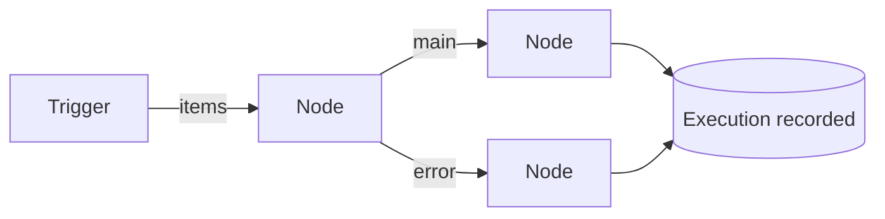

A workflow is a graph: nodes joined by connections, from an output port of one to an input
port of another, starting from a trigger. The graph, as JSON, is the workflow; the editor's
canvas and the Code view are two ways of editing it.

## The model

A node has an ID, a type (`logic.if`, `trading.placeOrder`, `custom.spread`,
`plugin.movers.alert`), a name, its settings, and whether it continues on failure. Items flow
between nodes, each a JSON object with a note of where it came from. A node gets the items on
each of its input ports and sends items out of its output ports: `main`, `error`, or ports of
its own, like If's `true` and `false`, or one a setting adds.

Saving checks the graph: no node without an ID or with one twice, no connection to itself
or twice, no cycle, a trigger, every setting valid for its type, every expression compiling.
Each save is a new version; an edit names the version it started from, and a save from an
older one is refused, so two tabs cannot overwrite each other.

The node types a user sees are the built-ins, their own custom nodes and the plugins they
may use; the engine checks a workflow against that set at each run, not only at saving, so a
node that went away fails visibly rather than silently.

## A run

A trigger starts an execution with a batch of items. The engine runs the nodes in
topological order, ties in the order they were added, so a workflow runs the same way every
time. Each node runs once, with every item that reached it; a node no item reached is
recorded as skipped.

An item a node fails on goes out of its `error` port, with the reason. If the node continues
on failure, those items flow on like any others; if not, the execution fails. A setting's
expression that fails takes its item out the same way. A node that panics fails, and only
its execution: one bad node cannot take the server down.

Executions from one trigger never overlap: the trigger waits for its execution to finish
before it starts another. Each execution records, per node, how it ended and how many items
went in and out of each port; runs by hand keep samples too, the first five items of each
port up to 16 KiB a node, for the editor to show.

## Triggers

A trigger runs as long as its workflow is active: a schedule, market activity (trades, book
changes, prices, batched over a window, at most 500 items a batch), a followed trader's
trades, a workflow's own orders, a Telegram message, or a plugin's trigger. One supervisor
keeps one runner per active workflow; saving an active workflow restarts it, and the old
version stops before the new one starts, so two versions never run side by side.

When the server starts, it starts every active workflow again, telling each trigger it is
resuming. The trader trigger then catches up on trades from the last two minutes, at most an
hour, and skips older ones, counting them, rather than copying a trade late. Trades it has
handed on before are remembered, so a restart never sends one twice.

The market and trader feeds are one stream each for the whole server, however many
workflows watch them.

## Runs that wait

Some nodes wait: Telegram's Ask for an answer, Wait for a time. Such a node parks its
execution instead of holding a goroutine: the engine saves the execution as waiting, and a
snapshot of where it was, the workflow as it ran, the node and its input, what the other
nodes still have to run with. A waits service looks for due ones every two seconds; taking
one deletes it in the same statement, so it resumes exactly once, even after a restart that
came while it was due. An answer resumes it at once.

Each user may have 50 executions waiting, each for at most 7 days; past either, the node
fails. Switching a workflow off cancels its waits.

## Expressions

`{{ }}` in a setting is worked out for each item. A plain field path, `outcomes.0.price`, is
looked up directly; anything else is TypeScript, compiled and run in the
[user code engine](/docs/architecture/user-code/), once per node run for all its items. An
expression sees the item's fields, `params`, `execution` and `dec`; it cannot make data
requests, and a setting that is only an expression gets its value's type. Triggers, wallets,
credentials and ports take no expressions.

## Memory and code

Nodes like Only new, Throttle and Consensus remember across runs: values kept per workflow,
node and key, with an expiry, at most 10,000 keys a node, swept every ten minutes, and
forgotten when their node is removed.

The Code view's TypeScript is the same graph: the server compiles it with the workflow
builder, runs it in the code engine with no data requests, and returns the graph it
describes, which the editor then saves as any other edit.

## What is kept

An execution is recorded when it finishes or parks. Finished executions are kept for 30 days
by default (**Keep executions for**, on the Config page) and pruned daily; waiting ones are
kept until they finish. The browser hears of each execution as it finishes over one
server-sent events stream per tab, at most eight a user.

The library's built-in scenarios are workflows shipped in the code; shared ones are copies,
their personal settings (wallets, credentials) left out.

Limits, all on the Config page: 100 workflows a user, 20 active, 200 nodes a workflow,
schedules no faster than a second.
