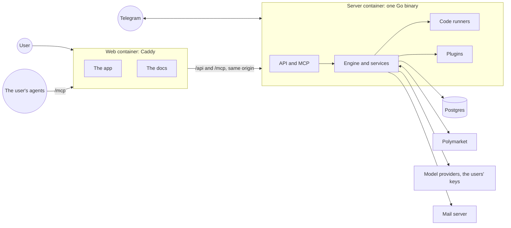
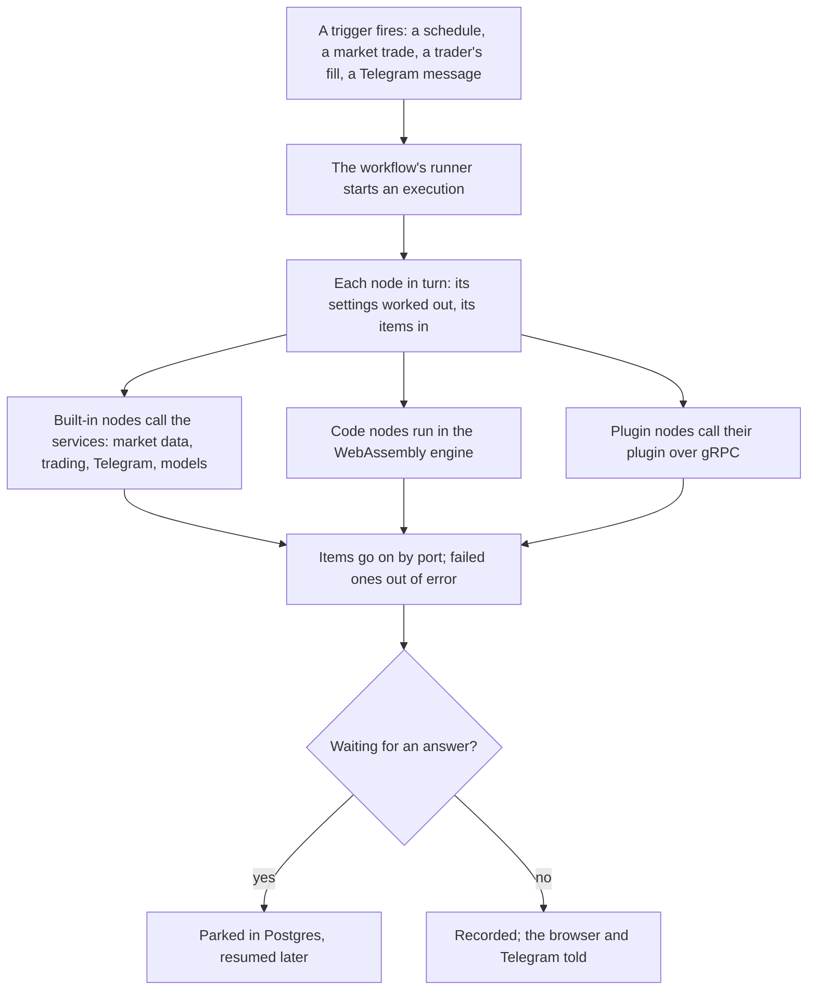

Polythought is workflow automation for Polymarket. Its users build workflows from nodes, on a
canvas or as TypeScript, that watch markets, follow traders, ask a language model, message them
on Telegram, and trade, on paper or with real money. It is meant to be run by anyone for a few
friends or for many strangers, and that shapes it: it lets its users write code and admins add
plugins, and keeps each user's code, keys and orders from everyone else's.

## The parts

- **The server** is one Go binary: the API, the MCP endpoint agents work through, the engine
  that runs workflows, and the services behind them, trading, accounts, Telegram, mail,
  plugins. The same binary, started another
  way, is the code runner and the sandbox's launcher, so there is one program to build, ship
  and trust.
- **The web container** is Caddy, serving the app and these docs as files and passing `/api`
  and `/mcp` to the server, so the browser sees one origin.
- **Postgres** keeps everything: workflows, executions, orders, settings, secrets, sealed.
- **Code runners and plugins**, where an instance uses them, are processes of their own beside
  the server, in a sandbox on Linux.

The three containers come with a Compose file; an instance is up with `make up` and a few keys
in its environment. Everything else is set by admins on the Config page while it runs.

## A run's way

A trigger runs while its workflow is on: a schedule, live market activity from one shared
stream, a followed trader's trades, a message to the bot. Each time it fires, the engine runs
the workflow's nodes in order. A node's settings may hold expressions, worked out for each item
in a sandbox; a code node's TypeScript runs in the same sandbox, a plugin's node in its plugin.
A node that trades goes through the trading service, which decides, for every order, whether
the workflow is on paper or live, and whether every switch on the way to live allows it. A node
that waits for an answer parks the run in the database, and the run resumes when the answer
comes, even after a restart. When the run ends it is recorded, and the user's open pages and,
if they chose, Telegram hear of it.

## What keeps it safe to share

- **Paper first.** Workflows trade on paper until their owner says otherwise, and live orders
  pass the instance's switch, the user's caps and their kill switch, every time.
- **Code in a box.** Users' code runs in WebAssembly, with no files, no network, and limits
  it cannot catch; on a public instance, in processes of its own in a Linux sandbox.
- **Plugins on a leash.** A plugin gets only the permissions an admin approved, runs in the
  same sandbox, and is held to the files the admin installed.
- **Secrets sealed.** Keys and tokens are encrypted before they reach the database, never
  shown again, and opened only where they are used.
- **Each user's own.** Workflows, credentials, wallets and model keys are their owner's; the
  instance holds no model key, and nothing calls a provider unless a user's workflow does.
- **Agents on a short leash.** An agent does only what its user ticked, its live actions wait
  for the user to confirm them, and the text others wrote reaches it marked as such.

## Reading on

[Workflows and runs](/docs/architecture/engine/), [User code and WebAssembly](/docs/architecture/user-code/),
[Plugins](/docs/architecture/plugins/), [Trading and its safety](/docs/architecture/trading/),
[Agents](/docs/architecture/agents/), [The security model](/docs/architecture/security/),
[Data and storage](/docs/architecture/data/), [Telegram, mail and notifications](/docs/architecture/messaging/),
[Observability](/docs/architecture/observability/), [The web app and the API](/docs/architecture/web/),
and the [key decisions](/docs/architecture/decisions/) behind them.
