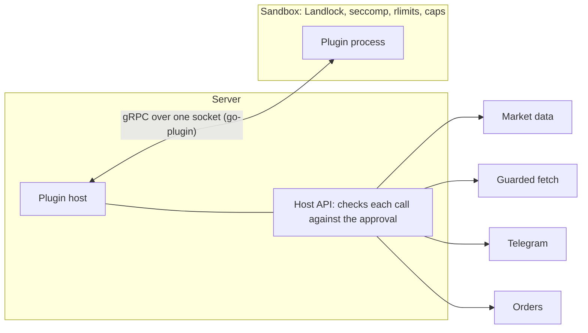

A plugin is a separate program, written in Go with Polythought's SDK, that adds nodes,
triggers, credential types and scenarios. It runs as its own process, talks to the server
over gRPC, and gets only what an admin approved. How to write one is in
[Write a plugin](/docs/self-hosting/write-a-plugin/); how admins run them, in
[Plugins](/docs/self-hosting/plugins/).

## Two services, one socket

The server starts each plugin with [go-plugin](https://github.com/hashicorp/go-plugin), with
TLS between them, and the plugin serves its nodes and triggers over gRPC. What the plugin
asks of the server, the host API, rides back over the same connection: the server opens no
socket of its own for it, which the sandbox could not reach anyway. The plugin's environment
is five variables, none of the server's.

Every call to the host names a session the server made for that run, valid only from that
plugin's process and only while the run lasts. The host API has 20 calls, each bounded:
messages up to 65 MiB, 128 calls in flight, four at a time per run, the run's data requests
counted as user code's are.

## Permissions

A plugin's manifest asks for permissions, and an admin approves exactly those, by name:

- **fetch:host** reaches one host over HTTP, through the same guard as webhooks, which
  refuses addresses inside the server's network; **fetch:\*** any public one. Each fetch is
  held to 10 seconds and 1 MiB.
- **wallets** sees the owner's wallet names and addresses.
- **telegram** messages the owner, or asks them a question the run waits on.
- **orders** places and cancels orders, from nodes that say they trade, as the trading nodes
  do, with every check of theirs.

Market data needs no permission. A node that remembers gets a store of its own, 1 MiB a
node. Logs, metrics and spans go to the server's own, capped too.

## What an admin installs

A plugin comes as an archive: its manifest, its program for each platform, and a checksum
of each. The server checks the archive when it is installed, when it is loaded, and before
each restart after a crash, and keeps the digest of its checksums, so the files approved are
the files that run. It then copies the program to a private directory, hashing as it copies,
and runs the copy.

Archives may be signed with minisign. An admin trusts signing keys on the Config page; a
plugin signed by a trusted key shows its signer, and once one is, later versions must be
signed by the same key. A signature that does not verify is refused; an unsigned plugin
installs only after the admin ticks a warning. Approving needs the permissions named one by
one, and the program must describe itself exactly as its manifest does. An upgrade that asks
for more waits beside the old version until approved, and changes load on restart. The
Plugins page keeps an audit of each.

## The sandbox

On Linux a plugin runs in the sandbox [user code's runners](/docs/architecture/user-code/#the-sandbox)
use: it reads its own files, writes a temporary directory, emptied when it stops, and a data
directory kept across upgrades, and nothing else; it connects to nothing, starts no process,
and runs as a static program, as the sandbox gives it no C library. Where there is no sandbox
a plugin does not start, unless an admin allows unsandboxed plugins, which the Plugins page
then warns of.

Each plugin is capped, 256 MiB of memory and 1 GiB of data unless an admin says otherwise.
A Go plugin's garbage collector is told to keep under its cap; the server reads its memory
every half second and stops it past the cap, and stops it at once past its data cap. A
plugin that crashes is restarted after a second, then longer, up to five minutes; five
crashes in ten minutes stop it until an admin starts it again, and admins are told. What it
writes to standard error reaches the log a hundred lines at once, then ten a second.

## Who uses it

A plugin's nodes are `plugin.<id>.<name>`, listed under Plugins in the node list, marked with
their plugin and, if they trade, so. A plugin is everyone's unless an admin chooses its users.
Its settings are its own, on its card, secret ones sealed. Workflows that use a plugin an
admin disables, removes or no longer lets their owner use are paused, and their owners told.
Uninstalling keeps the plugin's data unless asked, for a reinstall.
