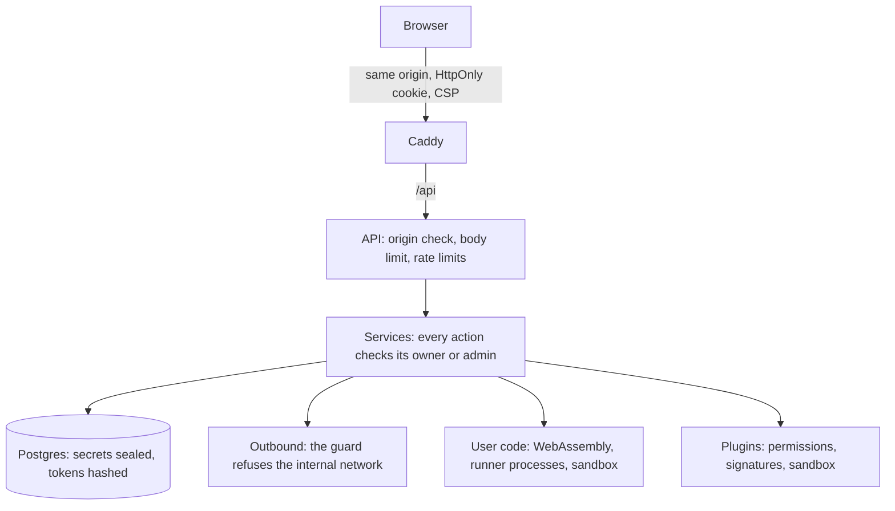

Polythought holds things worth stealing: keys that sign orders, API keys, other people's
workflows. Its defences are in layers, each meant to hold if the one before it fails.

## Accounts

Registration is by invite unless an admin opens or closes it. An invite's code is found by its
hash; using it and creating the account happen in one transaction, so an invite admits no more
sign-ups than it allows. A request to join reaches the admins only after its address was
confirmed by a mailed link.

Passwords are at least 12 characters, hashed with Argon2id and compared in constant time; a
sign-in with an unknown address checks a dummy hash, so it takes as long as a wrong password,
and whether an account is disabled or unverified is said only after the password is right.
Forms that could reveal which addresses have accounts, password reset, a new verification
link, a request to join, answer at once and the same way, and do their work after.

A session is a random 256-bit token, kept only as its hash, in an HttpOnly, SameSite=Lax
cookie, Secure and named `__Host-` over https, so a sibling subdomain cannot set it. Sessions
end after 7 idle days or 30 in all. API tokens are the same kind of secret, sent as a Bearer
header, with the scopes chosen as they were made, as agents' grants have them; a token made
before scopes has them all. A token does only what its scopes allow, on `/api/v1` and over
MCP alike: read; build, workflows, nodes and credentials; settings, the account's own;
paper; live; admin, for an admin. Every scope brings read. Paper and live are told apart
inside a route: setting a workflow live, or saving, switching on or running one that trades
live, needs live, as does turning the kill switch off; any token may turn it on. Every route
of the API that changes something names its scope, and one that names none takes no token.
Neither a token nor an agent ever does what needs a person at a browser: changing the
password, making or revoking tokens, storing wallet credentials, importing a private key,
approving session keys or a wallet's approvals, or allowing an agent.

Agents such as Claude Code sign in with OAuth 2.1, through the user's browser. The agent
registers, or names a metadata document at an https address it controls; the user sees on a
consent page which it is, verified by that document or not, and ticks what it may do, live
trading and admin unticked to start with. Only a browser session can allow it. The code it
gets back works once, for ten minutes, and only with the PKCE verifier the agent started
with. Its access token lasts an hour; its refresh token works once, for 30 days, and each
refresh gives a new pair. A code or refresh token used twice means a copy is about, so the
grant is revoked, with every token it gave. Tokens are kept only as hashes, and Settings lists
each agent allowed, to revoke.

At `/mcp`, every request's token is checked as it comes: an agent's with its grant and its
user, so revoking the agent or disabling its user stops it at once, and allowing it less
narrows the tokens it has. An admin can switch agents off for the whole instance. What an
agent or an API token reads of a workflow, over MCP or the API, leaves its personal settings
out, such as a webhook's URL, which can be a secret, unless its owner lets them see those, at
a browser; a workflow they save keeps those as they were. Nor do they delete workflows,
custom nodes or credentials, or share workflows to the library, unless the user lets them, at
a browser, each switch on its own. A credential's secret never comes back to them, but a
workflow they build could send it wherever its nodes call: they save, switch on or run a
workflow that uses one, test one, or change where one goes, only where the user lets them
use credentials, a switch of its own, off to start with. Nor do they answer the questions the
user's workflows ask, often how the user approves a trade, unless the user lets them, and the
question then says who answered. What reaches real money, going live, switching on, running
or changing a workflow that trades live, and turning the kill switch off, waits for the user
to confirm it at a browser, where they have it wait, as they do to start with; neither an
agent nor a token can confirm its own, or loosen those switches. An admin's agent's or
token's work on another user's role, account, caps or code access waits the same way, and so
does its changing Config, restarting the server, approving a plugin and changing plugins. It
never sees a user's email, never sets a secret setting, and creates no account with a
password unless an admin lets it; it invites instead.
Text others wrote comes marked as such.

Every admin action checks the role in the service, not only in the page, and the last admin
cannot be demoted or disabled. Disabling a user signs them out everywhere, stops their
workflows and turns their kill switch on, cancelling their resting live orders; they are
refused on their next request, by session, token, agent or Telegram.

## The browser

Caddy serves the app, the docs and the API on one origin, so there is no CORS to get wrong.
A request that changes something with the session cookie must come from that origin, by its
`Origin` or `Referer`; one with a Bearer token needs no such check, as browsers never add
the header themselves. Nor do the endpoints agents' programs call to sign in, which take no
cookie.

The app's Content-Security-Policy lets scripts come only from its own origin, frames from
none, and connections only to its own API. The docs' policy is the same, plus their few
inline scripts by hash, written when they build. Request bodies are capped at 1 MiB, except
plugin archives, which stream.

Rate limits are per address and per action: signing in (per address, and per address and
account, with a looser limit per account from everywhere so a stranger cannot lock its owner
out), signing up, resetting a password, verifying, invites, requests to join. Behind a proxy,
only the proxies an admin names may say what a client's address is.

## Secrets

Secrets are sealed with envelope encryption before they reach the database, each bound to its
row and field, under master keys from the server's environment; there is no fallback to plain
text. They never come back out of the API. [Data and storage](/docs/architecture/data/#sealed)
lists what is sealed and how keys rotate. Importing a private key is off on an instance with
open registration, and a key must control the wallet it is imported for.

## Reaching out

What a workflow or plugin asks the server to fetch goes through one guard, on every
connection and redirect, after DNS: addresses inside the server's network are refused,
private, loopback, link-local and the less common ranges that reach them, so a webhook cannot
be turned on the server's own services, and a name that resolves inside cannot either.
Webhooks, OpenAI-compatible model addresses, plugins' fetches, plugin archives fetched by
URL and agents' metadata documents all go through it, the last from public addresses unless
an admin allows otherwise with a setting of their own; an admin may let workflows reach private addresses, for a self-hosted
service beside the server. A webhook's extra headers go only to the host named; a redirect
elsewhere loses them.

The server itself calls Polymarket, Polygon's RPC, Telegram, the mail server, the model
providers a user's key names, and GitHub for the repository's stars, which an admin can turn
off.

## Code and plugins

User code runs in a WebAssembly engine with no files, network or environment, held to memory,
time and output, its data requests read-only and its owner's; on a public instance, in runner
processes kept to one owner each, in the Linux sandbox. See
[User code and WebAssembly](/docs/architecture/user-code/).

Plugins run in the same sandbox, get only the permissions an admin approved by name, and are
held to the files that were approved; a signed plugin's later versions must be signed by the
same key. See [Plugins](/docs/architecture/plugins/). Neither ever sees the server's
environment, so neither has its database's address or its keys.

## What is recorded

The Config page keeps a history of every change, who made it and when, secrets only as
changed; plugins keep an audit of every install, approval and change, with its source,
signer and digest. The log records sign-ins and their failures, tokens made, accounts changed
and by whom, and requests refused for their origin, with route templates, never paths that
might carry an ID or a token.
