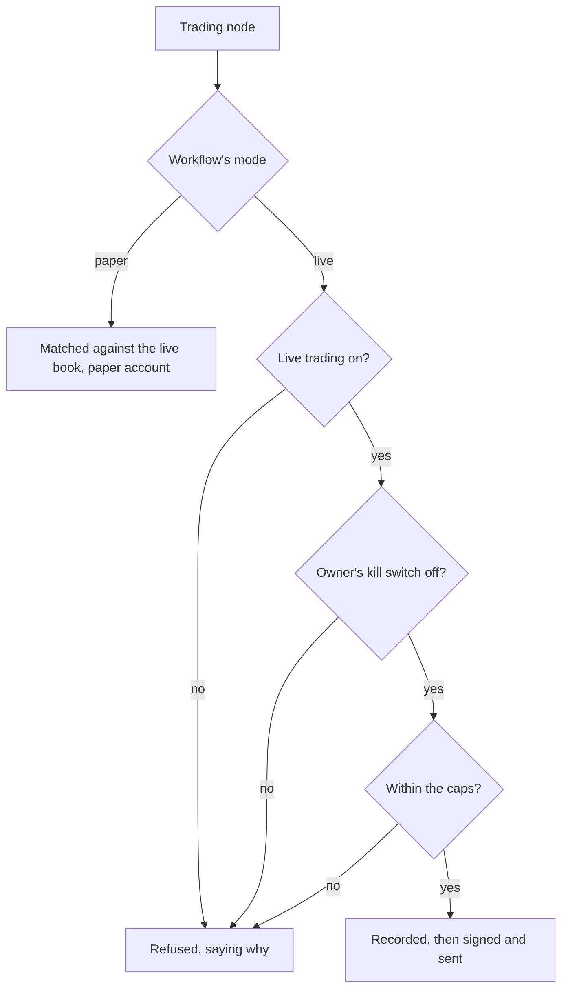

Every workflow trades on paper until its owner switches it to live. Live orders are signed
by the server, in Go, and pass the same checks every time before any is sent.

## Paper

A workflow on paper has a paper account, opened with **Paper balance** ($1,000 unless an admin
says). A paper order is checked as Polymarket checks an order, price on the tick, size, cash
for all it could spend, then matched against the market's live book, best price first, within
its limit, paying the taker fee Polymarket would. A resting paper order fills only when the
market trades through its price: a trade at exactly its price might not have reached it in the
queue. Holdings are kept per workflow, mode, trader and token, at average cost, valued at the
book's midpoint, and settled when their market resolves.

## Live

A workflow goes live from one of its owner's wallets, which must be able to sign: an imported
private key, or a session key the owner approved in their browser wallet. Going live, or
moving to another wallet while live, asks the owner to confirm that its orders spend real
money. One mode and one wallet hold for all of a workflow's trading nodes, and the trading
service reads them at each order, not what the run believed.

### Signing

Orders are signed in Go with go-ethereum, as EIP-712 typed data for Polymarket's exchanges, for
every wallet kind Polymarket has: an EOA, a proxy, a Safe, a Deposit Wallet, with or without a
session key. Amounts are worked out exactly, in millionths, rounding down, as Polymarket's own
client does; a price off the tick is refused, never rounded.

None of this was taken on trust. Signatures, amounts and request bodies are checked byte for
byte against vectors generated from Polymarket's official TypeScript client, pinned to a
commit and run in a container: 29 signatures, 360 amounts, the authentication headers, the
session-key batches. The tests never trade.

### Sending

A live order is recorded, with its hash, before it is sent: if the record fails, nothing is
sent. An order with no answer is looked up by its hash before it is sent again, so a timeout
never places it twice. The server then follows each order every five seconds, for up to a day:
fills as they match, trades that later fail on chain undone in the books, an order Polymarket
never saw marked refused after ten minutes.

## The switches

- **Live trading**, for the whole instance, off to start with. Off, no workflow places a live
  order; turning it off cancels every live order resting on the book, every user's, after
  asking.
- **Caps** on live buys: $100 an order and $1,000 a day unless an admin says, for the instance
  and per user. The day cap counts the last 24 hours' buys with their fees, what unsettled
  buys may still spend, and what is being sent at that moment, under one lock per user, so two
  runs at once cannot both pass it.
- **The kill switch**, each user's, in the top bar. On, it refuses every live order before it is
  sent and cancels the user's resting ones; turning it on is instant, turning it off asks.
  Disabling an account turns it on. A sweep every 30 seconds cancels any order that came to
  rest after a switch went on.
- **Geoblock**: whether Polymarket takes orders from the server's address, checked at start,
  every six hours and on demand. It warns admins and holds nothing back: Polymarket refuses
  the orders itself.

Before each live order the server checks, in order: live trading is on, a wallet is chosen,
the kill switch and the caps, enough free shares for a sell, and the key unseals. Resting live
orders are cancelled when their workflow goes back to paper, is deleted, or loses its wallet;
switching a workflow off offers to cancel them.

## The trading nodes

Copy sizing scales a followed trader's trades to a budget, Risk guard holds back buys past
limits, Place order and Place orders send one or a batch (up to 15, not atomic), Cancel orders
cancels the workflow's own. Each sends what it could not do out of a port of its own:
skipped, blocked, missed, resting. Owners are told of fills, refusals and the rest as they
choose, at most 20 of a kind an hour, then a summary.
