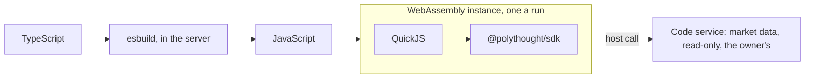

Users write code in four places: the code nodes (Transform, Filter, Route, Aggregate),
their own custom nodes, expressions in a node's settings (`{{ }}`), and whole workflows as
TypeScript in the editor's Code view. All of it is TypeScript, compiled by the server and
run in a JavaScript engine that is itself a WebAssembly module.

## Compiling

The compiler is esbuild, through its Go API, inside the server. It builds ES2023 as one
function, reads nothing from disk, and refuses every import but `@polythought/sdk` (and,
for workflow code, `@polythought/workflow`): code reaches no npm package and no network. A
compile takes about a millisecond, so compiled code is cached in memory by its hash, 256
programs and 4,096 expressions, and no more than half the server's CPUs compile at once.

The server does not type-check. Code that compiles is accepted; the editor checks types in
the browser with Monaco's TypeScript worker, against declarations the server writes for
each user (their custom nodes and plugins included), and shows the errors without blocking
a save. Sources are capped at 256 KiB, expressions at 16 KiB.

## Why WebAssembly

The engine is QuickJS-NG, compiled to WASI with wasi-sdk into a 1.1 MB `engine.wasm` that
ships inside the binary, and run by [wazero](https://wazero.io/), a WebAssembly runtime in
pure Go. The options weighed, and why they lost:

- **goja**, a JavaScript engine in Go: no cap on its heap, so one large string could take
  the server's memory.
- **V8 through cgo**: cgo for every build, and builds of the binding broken for over a year.
- **QuickJS translated to Go**: fast, but with no boundary, a bug in the engine would be a
  bug in the server's memory.
- **Node or Bun beside the server**: Node's own documentation says its permission model does
  not protect against malicious code; sandboxes built on it keep being escaped.

WebAssembly gives a hard memory boundary: the engine sees its own linear memory and nothing
else, its pages are capped, and a context's deadline stops it mid-instruction. The module
imports four functions from the server (a host call, reading its answer, an interrupt check
and a log line) and the WASI clock and random source: no files, no network, no environment.
The engine is compiled once at start; each run gets a fresh instance, in about 2 ms, so
nothing is left over from one run to the next. The SDK's prelude and each program are kept
as QuickJS bytecode, so a run of a small node takes about a millisecond.

The same engine runs expressions, without host calls.

## What code can do

The SDK gives decimals (`dec()`, over big.js), item helpers, and read-only market data:
searching markets, an order book, positions. Each request is a host call, answered by the
server for the code's owner alone, bounded (50 markets a search, 50 levels a book, 500
positions) and counted. The SDK removes the raw call from the global scope, so code reaches
the server only through it.

Each run is held to settings on the Config page, read live:

| Setting | Default | Past it |
| --- | --- | --- |
| Memory per run | 64 MiB | the run fails, even if the code catches the error |
| Time per run | 5 s, host calls included | the run stops; it cannot be caught |
| Output per run | 1,024 KiB | the run fails |
| Data requests per run | 100 | the run fails |

Runs at once default to one a CPU, and one owner gets at most half of them, so one user's
code never keeps everyone else's waiting.

## Runner processes

By default the engine runs inside the server's process, which suits an instance whose users
trust each other. A public instance turns on **Runner processes** (Code, on the Config page):
code then runs in a pool of separate processes, one run each at a time.

A runner is the server's own binary, started in a mode that runs only the engine, and it
talks to the server over its standard input and output in length-prefixed JSON frames, each
naming its run. A frame for no run, for another, or larger than its run allows ends the
runner. A runner keeps to its owner: a run takes an idle runner of its owner's, or a fresh
one, and a runner that ran another owner's code is restarted first, so code that broke out
of WebAssembly would still find nothing of anyone else's.

The server does not trust a runner to keep its own limits. It holds each run to its time
with a little grace, reads the runner's memory every half second and ends one past twice the
run's memory and some headroom, and counts the data requests, output and log lines again on
its side. A runner that crashes fails its own run and is replaced.

## The sandbox

On Linux, runners start inside the same sandbox as [plugins](/docs/architecture/plugins/):

- **Landlock** lets the process read its program and write two directories of its own;
  nothing else on disk, and no TCP at all.
- **seccomp** refuses what code never needs: tracing other processes, mounts and namespaces,
  BPF and kernel modules, `connect`, shared memory, starting processes, signals to others.
- **rlimits** cap its open files, its data and the size of any file, and forbid core dumps;
  it runs at a lower priority, in a session of its own, with no terminal.

The sandbox needs Linux 6.2 or later. Elsewhere, runners still start, still inside
WebAssembly and its limits, and the Config page says in amber that they are not sandboxed.
If they cannot start at all, code fails and says why; it never falls back into the server.

## Who may write code

**Code access** (Code, on the Config page) is everyone, admins and chosen users, or no one.
It covers code nodes and custom nodes, not expressions. A workflow whose owner may no longer
write code stays on, and fails at its trigger, before any node runs, saying why. Each user may
have 50 custom nodes, of 64 KiB of code, 20 settings and 10 outputs each.
