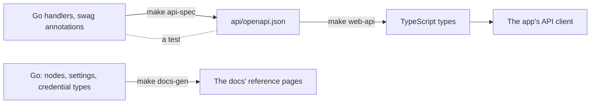

## The API

The API is served by the Go server with [Hertz](https://github.com/cloudwego/hertz), under
`/api/v1`. Handlers translate HTTP into calls to the services and back; who may do what is
decided in the services, not the handlers, so the API, Telegram and the engine are held to the
same rules. Errors share one shape, `{"error": {"code", "message"}}`, with a stable code for
each.

The API is written code first. Each handler carries swag annotations; `make api-spec` turns
them into an OpenAPI 3.1 file, committed in the repository, and `make web-api` turns that into
the app's TypeScript types. A test fails when the routes the server serves and the routes the
spec describes differ, and the checks fail when either file is stale, so the app cannot call an
endpoint that is not there, or send a field the server does not read, without a type error.

The browser hears of executions as they finish over server-sent events, one stream per tab,
pinged every 15 seconds, which the app folds into its cache, so pages update without polling.

## The app

The app is React 19 with react-router, built with Vite, its server state in TanStack Query
through a typed `openapi-fetch` client. Its components are shadcn's, over Radix, styled with
Tailwind. The editor's canvas is React Flow; its code fields are Monaco, loaded only when a
page needs them, with TypeScript's language service checking users' code against the
declarations the server writes for each of them. Monaco's workers are files of the app's own
origin, so its Content-Security-Policy allows scripts from that origin and nothing else.

It is tested two ways: vitest against a stand-in API (MSW) for each page and component, and
Playwright against the real stack in Docker, the server, Postgres, Caddy and a mail catcher,
signing in, building, running and trading on paper as a user does.

## One origin

Caddy serves the app, the docs and the API from one origin. The session cookie then needs no
cross-site settings, the API's origin check has one origin to compare with, and there is no
CORS to configure, or to get wrong. Agents' endpoint, `/mcp`, and the OAuth metadata they look
for under `/.well-known` go to the API too. In development, Vite passes them, `/api` and
`/docs` to their servers the same way.

## The docs

These docs are [Starlight](https://starlight.astro.build/), built to files and served by Caddy
at `/docs`. The reference, every node and its settings, every setting of the instance, every
credential type, the code SDK's types, is generated from the Go code by `tools/docgen`, and a
test fails when it is stale, so it matches the version that is running. Diagrams are Mermaid,
drawn into SVG as the docs build, so a page carries no script for them; search is Pagefind's,
which runs in the browser. Their Content-Security-Policy allows their few inline scripts by
hash, written as they build.
